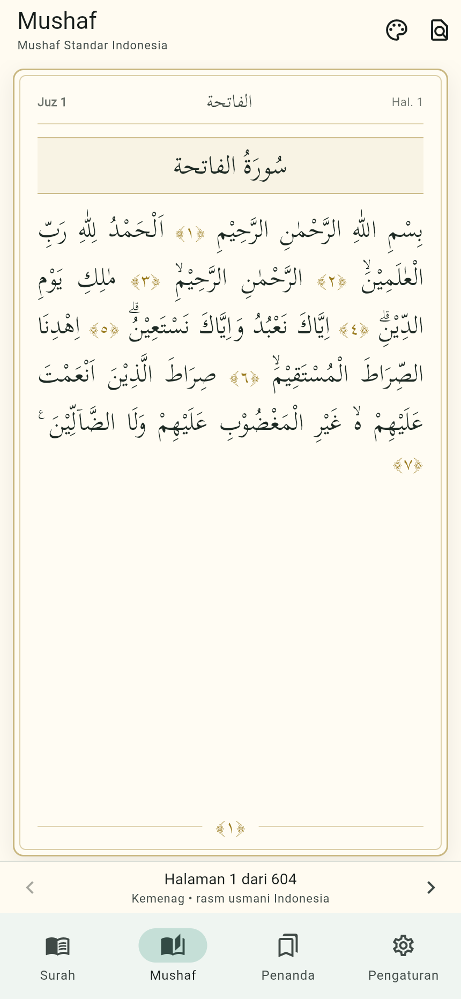

<p align="center">
  
</p>

<h1 align="center">Al-Qur'an</h1>

<p align="center">
  A calm, offline-first Qur'an reader for Indonesian readers — with Arabic text,
  Indonesian translation, Madinah and Kemenag mushaf layouts, per-ayah audio,
  colour-coded bookmarks, a light/dark theme, and shared reading challenges with
  friends.
</p>

<p align="center">
  
  
  
  
  
</p>

---

## Contents

- [Screenshots](#screenshots)
- [Key Features](#key-features)
- [Tech Stack](#tech-stack)
- [Architecture](#architecture)
- [App Icon & Splash Screen](#app-icon--splash-screen)
- [Setup & Installation](#setup--installation)
- [Data Sources & Credits](#data-sources--credits)
- [Notes & Limitations](#notes--limitations)

## Screenshots

<table>
  <tr>
    <td width="50%" align="center">
      <br>
      <strong>Light mode</strong>
    </td>
    <td width="50%" align="center">
      <br>
      <strong>Dark mode</strong>
    </td>
  </tr>
  <tr>
    <td width="50%" align="center">
      <br>
      <strong>Ayah-by-ayah reading</strong>
    </td>
    <td width="50%" align="center">
      <br>
      <strong>Mushaf page reading</strong>
    </td>
  </tr>
  <tr>
    <td width="50%" align="center">
      <br>
      <strong>Settings &amp; theme picker</strong>
    </td>
    <td width="50%" align="center">
      <br>
      <strong>Theme picker in dark mode</strong>
    </td>
  </tr>
</table>

> Screenshots cover the reading experience. The **Tantangan** (reading
> challenge) screens are not captured yet because they need a signed-in
> Firebase project.

## Key Features

### Reading experience
- **Ayah-by-ayah mode** — Arabic text, Indonesian translation underneath each
  verse, adjustable Arabic font size, per-ayah audio, and a bookmark action on
  every verse.
- **Page-by-page mushaf** — a horizontal `PageView` across 604 pages, complete
  with juz markers, surah headings, basmalah, ayah-end ornaments, and Arabic
  page numbers.
- **Two authentic mushaf layouts** — Madinah (Uthmani text) and Mushaf Standar
  Indonesia/Kemenag, each with its own page breaks and Arabic script style.
- **Arabic typography** — bundled Amiri Quran and Scheherazade New fonts. The
  font size slider applies to the ayah reader and is persisted.

### Bookmarks
- Save any ayah with one of four colour categories: **red, green, yellow, or
  blue**.
- Bookmarks are grouped by colour, filterable, sortable by recency, and can be
  removed by swipe with an undo action.
- Tapping a bookmark opens its surah and scrolls directly to the saved ayah,
  highlighting it on arrival.
- Bookmarks are stored locally in Hive, so they survive app restarts and work
  without a connection.

### Reading challenges with friends
- **Sign in without friction** — anonymous sign-in for a stable Firebase UID, or
  email/password registration and login.
- **Create a group** — each challenge gets a unique 6-character invite code
  (no ambiguous `I`, `O`, `0`, or `1`), reserved in Firestore inside a
  transaction so two groups can never share a code.
- **Join with a code** — friends enter the code, become members, and appear on
  the leaderboard immediately.
- **Live leaderboard** — Firestore streams every member's furthest reading
  position. Rows show rank, name, last surah/ayah reached, a progress bar, and
  the percentage of the Qur'an completed.
- **Automatic progress sync** — opening a surah (the first visible ayah) or
  swiping the mushaf records the position locally in Hive and pushes it, with a
  short debounce, to every group the reader belongs to.
- Owners can delete their group; members can leave at any time without losing
  their local reading position.

### Light & Dark Mode
- Three theme preferences: **Terang**, **Gelap**, and **Sistem** (follow the
  device).
- A quick sun/moon toggle in the surah list app bar and a segmented control in
  **Pengaturan → Tema**.
- Selection is persisted in Hive and restored on startup; theme changes animate
  smoothly.
- Every screen uses the app's custom `ThemeData`/`ColorScheme` for backgrounds,
  cards, text, icons, dividers, sheets, and navigation. The mushaf page has a
  dedicated parchment palette for each brightness.

### Data & offline support
- Quran text, Indonesian translation, and audio URLs from **equran.id**.
- Madinah/Uthmani text enrichment from **Quran.com**.
- Surah lists and details are cached in Hive with TTL and stale-cache fallback.
- Mushaf page boundaries are bundled as an asset, so page navigation and juz
  metadata are available offline.

## Tech Stack

| Layer | Technology |
| --- | --- |
| Framework | Flutter 3.47+ / Dart 3.13+ |
| State management | Riverpod 3 (`Notifier`, `AsyncNotifier`, `StreamProvider`, `*.family`) |
| Backend | Firebase Core, Firebase Auth (anonymous + email), Cloud Firestore |
| Local storage | Hive 2 (bookmark adapter, settings, reading-progress cache) |
| Networking | `http` with a small `ApiClient` error-mapping layer |
| Audio | `just_audio` (murottal per ayah) |
| Long lists | `scrollable_positioned_list` for jump-to-ayah scrolling |
| App icon | `flutter_launcher_icons` 0.14.4 |
| Splash screen | `flutter_native_splash` 2.4.8 |
| Lints | `flutter_lints` |

## Architecture

The code follows a three-layer clean architecture, with Riverpod as the
dependency/state bridge:

```text
lib/
├── main.dart                  # Hive + Firebase bootstrap, ProviderScope
├── app.dart                   # MaterialApp + persisted themeMode
├── core/
│   ├── constants/             # endpoints, Hive names, assets, TTL
│   ├── error/                 # user-facing Failure type
│   ├── network/               # JSON ApiClient with timeout handling
│   ├── theme/                 # custom light/dark ThemeData + bookmark palette
│   └── utils/                 # Arabic digits, HTML stripping, invite codes
├── domain/
│   ├── entities/              # Ayah, Surah, Mushaf*, Bookmark, AppSettings,
│   │                          # AppUser, ReadingGroup, MemberProgress, ReadingProgress
│   ├── repositories/          # repository contracts (Quran, bookmarks, auth, challenge)
│   └── usecases/              # reading, bookmark, auth, challenge, progress use cases
├── data/
│   ├── datasources/           # Quran remote/Hive, Firebase Auth, Firestore, progress box
│   ├── models/                # API JSON, Hive adapter, Firestore group/member models
│   └── repositories/          # cache-first and Firebase-backed implementations
└── presentation/
    ├── pages/                 # shell, surah list, readers, challenge, group detail, settings
    ├── providers/             # Riverpod providers, settings, audio, auth, challenge, progress
    └── widgets/               # ayah tile, colour sheet, mushaf page, invite code card
```

Firestore security rules are kept in [`firestore.rules`](firestore.rules) at the
repository root.

**Theme flow:** `SettingsNotifier` exposes `AppSettings`, including
`AppThemeMode`. `QuranApp` watches only the theme preference with
`select`, maps it to Flutter's `ThemeMode`, and rebuilds `MaterialApp` when it
changes. `SettingsRepositoryImpl` writes the choice to the `settings` Hive box
under `theme_mode`.

**Challenge flow:** `main()` calls `Firebase.initializeApp()` and exposes the
result through `firebaseReadyProvider`, so the reader still works offline when
Firebase is not configured. `AuthRepository` maps Firebase users to `AppUser`.
`ChallengeRepository` creates groups and invite codes, streams the groups of the
signed-in user (`groups` filtered by `memberUids`) and streams member progress
(`groups/{id}/members`). `ReadingProgressNotifier` stores the furthest position
in Hive immediately and syncs it to Firestore after a two-second debounce; the
leaderboard updates from the live Firestore stream.

## App Icon & Splash Screen

Both generators are configured in `pubspec.yaml`; the artwork lives in
`assets/icon/`.

| Asset | Purpose |
| --- | --- |
| `assets/icon/icon.png` | 1024 × 1024 master icon: open book and star in gold on emerald |
| `assets/icon/icon_foreground.png` | Transparent foreground for Android adaptive icons |
| `assets/icon/splash_icon.png` | Centred native splash mark for Android ≤ 11 and iOS |
| `assets/icon/splash_icon_android12.png` | Android 12+ splash glyph on the system icon background |

### Icon configuration

- Android adaptive background: `#0F5B4E`
- Source image: `assets/icon/icon.png`
- iOS alpha channel removed automatically
- Web, macOS, and Windows icons generated from the same master

### Splash configuration

- Light background: `#FFFBF1` (app light surface)
- Dark background: `#16201C` (app dark surface)
- Centred icon only, no branding text
- `image_dark` enables the dark-mode splash
- Android 12 uses the dedicated glyph and `#0F5B4E` icon background

### Generate the native assets

Run these from the project root after changing the icon or splash artwork:

```bash
# Launcher icons for Android, iOS, web, macOS, and Windows
dart run flutter_launcher_icons

# Native splash screens for Android, iOS, and web (light + dark)
dart run flutter_native_splash:create
```

Optional: remove generated splash files again with:

```bash
dart run flutter_native_splash:remove
```

> The web splash uses the `flutter-first-frame` event in `web/index.html` to
> remove itself after Flutter renders. Keep that listener if you regenerate the
> web splash.

## Setup & Installation

### Prerequisites

- Flutter 3.47 or newer, with a configured Android/iOS toolchain
- Dart 3.13 or newer (bundled with Flutter)
- Internet access on first launch for surah text and audio
- Firebase CLI and a Firebase project (only for the reading challenges)

### Firebase setup (reading challenges)

The reader works without Firebase, but the challenge tab needs a configured
project:

1. Run `flutterfire configure` once. This project already has
   `android/app/google-services.json` and `ios/Runner/GoogleService-Info.plist`
   plus the `com.google.gms.google-services` Gradle plugin wired in.
2. In **Firebase Console → Authentication → Sign-in method**, enable
   **Anonymous** and **Email/Password**.
3. Create a **Cloud Firestore** database (production mode) and apply
   `firestore.rules`:

   ```bash
   firebase deploy --only firestore:rules
   ```

   Or paste the contents of `firestore.rules` into the console's Rules tab.
4. Launch the app and open the **Tantangan** tab.

The Firestore layout is:

| Path | Fields |
| --- | --- |
| `groups/{groupId}` | `name`, `code`, `ownerId`, `createdAt`, `memberCount`, `memberUids` |
| `groups/{groupId}/members/{uid}` | `displayName`, `surahNumber`, `surahName`, `ayahNumber`, `versesRead`, `updatedAt` |
| `groupCodes/{code}` | `groupId`, `createdAt` — reserves each invite code once |

> Progress is measured in verses (6236 in total), so members who read long and
> short surahs compare fairly. The app records the furthest position reached,
> not the current page.
>
> The challenge tab is mobile-only for now: web builds need a registered
> Firebase web app, and `Firebase.initializeApp()` would have to receive the
> generated `firebase_options.dart` values. Without them the app still runs and
> the tab shows its disabled state.

### Run locally

```bash
git clone <your-repository-url>
cd my_quran

flutter pub get

# Generate launcher icons and splash screens
dart run flutter_launcher_icons
dart run flutter_native_splash:create

flutter run
```

For a release web build:

```bash
flutter build web --release
```

### Quality checks

```bash
flutter analyze
flutter test
```

The test suite covers page-index resolution, both bundled 604-page mushaf
indexes, Hive bookmark persistence, settings/theme persistence, mushaf page
rendering, cumulative verse progress, and invite-code generation/normalization.

## Data Sources & Credits

- **Text, translation, and per-ayah audio** — [equran.id API v2](https://equran.id/apidev/v2)
- **Madinah Uthmani text** — [Quran.com API v4](https://api-docs.quran.com/)
- **Madinah page metadata** — [Al Quran Cloud](https://alquran.cloud/api)
- **Kemenag page index** — [quran-json-kemenag](https://github.com/dyazincahya/quran-json-kemenag)
- **Arabic fonts** — [Amiri Quran](https://github.com/aliftype/amiri) and
  [Scheherazade New](https://software.sil.org/scheherazade/), both licensed under
  the SIL Open Font License. Licence files are in `assets/fonts/`.

## Notes & Limitations

- Page numbers differ between the two mushaf styles for the same verse because
  their page boundaries differ; this is intentional.
- A network connection is required for the first load of a surah or page.
  Subsequent reads use the Hive cache.
- If Quran.com is unavailable, the Madinah option falls back to Kemenag Arabic
  text while keeping the selected typography.
- Audio playback depends on the platform's network/audio support; web playback
  may be subject to the CDN's CORS policy.
- Challenge progress needs a signed-in Firebase user and a reachable Firestore
  database. Recording your position never depends on the network; only the
  leaderboard sync does.
- Anonymous accounts are tied to the device/app installation. Use an email
  account to keep challenge membership after reinstalling.
- Screenshots in this README were captured from the running app (Chrome, mobile
  viewport) in light and dark system themes.
