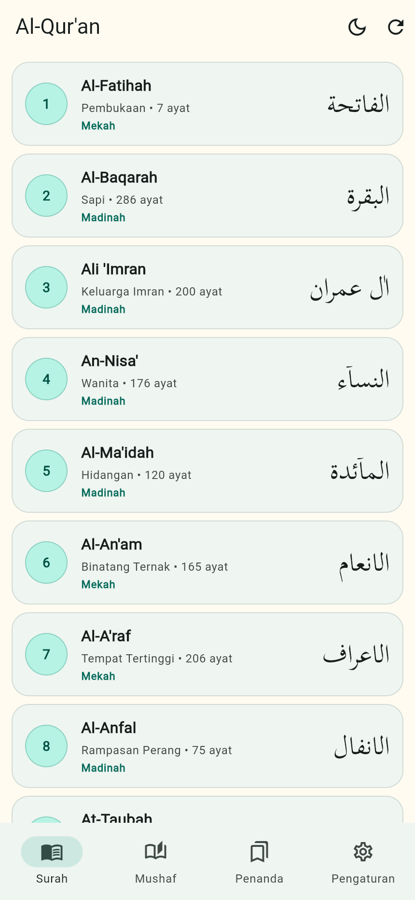
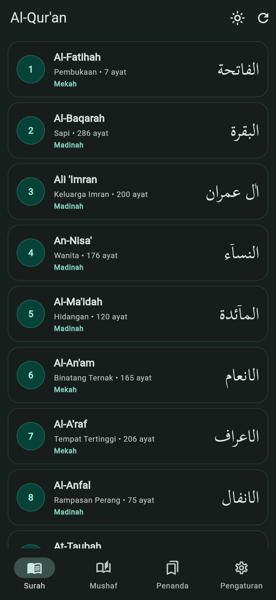
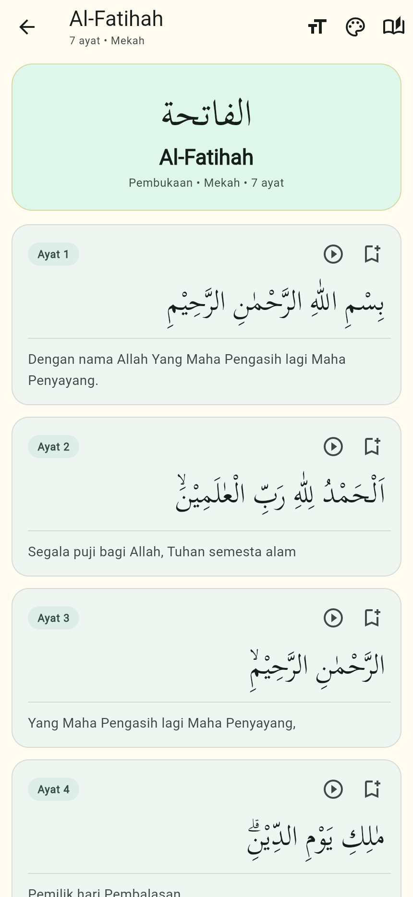
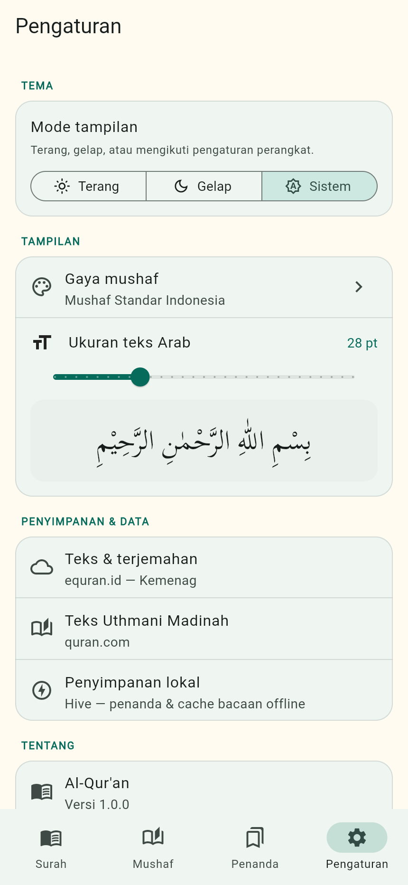
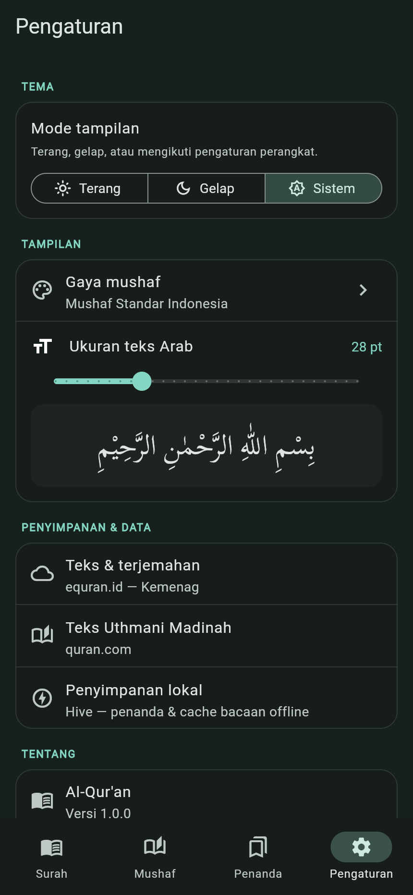

<p align="center">
  
</p>

<h1 align="center">Al-Qur'an</h1>

<p align="center">
  A serene, offline-first Quran and Islamic companion application built with Flutter — featuring dashboard-first navigation, immersive distraction-free reading, dual-script Mushaf reading (Madinah & Kemenag), Ayah-by-Ayah translation and audio playback with a translation toggle, a single active bookmark that doubles as the continue-reading position, customizable light/dark themes, collaborative group reading challenges via Firebase, accurate prayer times with Adhan notifications, and interactive Home Screen Widgets for Android and iOS.
</p>

<p align="center">
  
  
  
  
  
  
  
</p>

---

## Table of Contents

- [Screenshots](#screenshots)
- [Core Features](#core-features)
  - [Dashboard & Immersive Reading](#1-dashboard--immersive-reading)
  - [Ayah-by-Ayah Reader](#2-ayah-by-ayah-reader)
  - [Page-by-Page Mushaf](#3-page-by-page-mushaf-604-pages)
  - [Active Bookmark & Continue Reading](#4-active-bookmark--continue-reading)
  - [Dark & Light Theme](#5-dark--light-theme)
  - [Firebase Reading Challenges & Collaboration](#6-firebase-reading-challenges--collaboration)
  - [Prayer Times, Adhan Notifications & Home Widgets](#7-prayer-times-adhan-notifications--home-widgets)
- [Tech Stack](#tech-stack)
- [Architecture](#architecture)
- [Platform Configuration (Android & iOS)](#platform-configuration-android--ios)
  - [Android Setup](#android-setup)
  - [iOS Setup](#ios-setup)
- [App Icon & Splash Screen](#app-icon--splash-screen)
- [Setup & Installation Steps](#setup--installation-steps)
- [Testing & Quality Check](#testing--quality-check)
- [Data Sources & Credits](#data-sources--credits)
- [Known Limitations](#known-limitations)

---

## Screenshots

<table>
  <tr>
    <td width="50%" align="center">
      <br>
      <strong>Light Mode (Surah List)</strong>
    </td>
    <td width="50%" align="center">
      <br>
      <strong>Dark Mode (Surah List)</strong>
    </td>
  </tr>
  <tr>
    <td width="50%" align="center">
      <br>
      <strong>Ayah-by-Ayah Reading</strong>
    </td>
    <td width="50%" align="center">
      <br>
      <strong>604-Page Mushaf Reader</strong>
    </td>
  </tr>
  <tr>
    <td width="50%" align="center">
      <br>
      <strong>Settings &amp; Theme Picker</strong>
    </td>
    <td width="50%" align="center">
      <br>
      <strong>Settings in Dark Mode</strong>
    </td>
  </tr>
</table>

---

## Core Features

### 1. Dashboard & Immersive Reading
- **Dashboard-First Workflow**: The **Beranda** tab opens with a Hijri calendar card (Umm al-Qura) beside the Gregorian date, then a continue-reading card with Qur'an completion percentage, two primary reading modes (Baca per Ayat and Mushaf), and shortcuts to prayer times, group challenges and bookmarks. Settings is reachable from the dashboard app bar.
- **1D1J Daily Target**: A **1 Hari 1 Juz** card sits directly below Lanjutkan Bacaan, showing today's 20-page target, live percentage and a progress bar. Progress follows the actual reading position, can be topped up by one page, or marked complete; completion is pushed automatically to every joined reading group. Tapping the card opens the active target in Ayah or Mushaf mode.
- **Clean Five-Tab Navigation**: Beranda, Surah, Mushaf, Shalat and Penanda — fewer tabs and no duplicated settings destination.
- **Safe Exit**: A double back press leaves the app. The first press shows "Tekan sekali lagi untuk keluar aplikasi" and the app only closes if the second press follows within 2 seconds.
- **Landscape Layout**: In landscape the bottom bar is replaced by a slim `NavigationRail`, freeing vertical space for reading.
- **Immersive Reader Mode**: Toggle from the reader app bar, or rotate to landscape to activate it automatically. The app bar and mushaf footer disappear; a floating control restores them and the mushaf keeps a compact page badge with previous/next buttons.
- **Reading Preferences**: Arabic text size and translation visibility are persisted settings. The font slider scales both the ayah list and the page-by-page mushaf.

### 2. Ayah-by-Ayah Reader
- **Bilingual Display**: Arabic text alongside Indonesian translation for every verse, with a one-tap app-bar toggle to hide the translation and read clean Arabic only.
- **Audio Recitation**: Per-ayah streaming murottal audio powered by `just_audio`.
- **Customizable Typography**: Real-time adjustable Arabic font size slider, persisted locally and also applied to mushaf pages.
- **Fast Navigation**: Jump straight to any surah or verse with smooth animated scrolling (`scrollable_positioned_list`).
- **Quick Action Bar**: Instantly bookmark or play audio for any individual ayah.

### 3. Page-by-Page Mushaf (604 Pages)
- **Authentic Dual Layouts**:
  - **Madinah Mushaf**: Classic Uthmani script based on King Fahd Complex standards.
  - **Kemenag Mushaf**: Standard Indonesian layout (Mushaf Standar Indonesia) verified by the Ministry of Religious Affairs (Kemenag).
- **Faithful Page Layouts**: Exactly 604 pages rendered via high-performance horizontal paging (`PageView`), complete with juz markers, surah heading banners, basmalah calligraphies, and Arabic page numbering.
- **Tap-to-Bookmark Ayat**: Tap any ayah directly in the mushaf page to open its action sheet with the verse preview and translation. The saved verse is highlighted with a soft gold tint on the page.
- **Immersive Landscape Paging**: In landscape the reader hides its chrome and shows a floating page badge with previous/next controls.
- **Offline Asset Index**: Pre-indexed surah and ayah page boundaries bundled in JSON format for instantaneous, offline page resolution.

### 4. Active Bookmark & Continue Reading
- **One Active Bookmark**: The app keeps exactly one saved verse. Marking a new ayah replaces the previous marker, so the bookmark list never turns into clutter.
- **Simultaneous "Lanjutkan Bacaan"**: Saving a bookmark also moves the reading position to that verse and syncs it to every group challenge through the usual debounced Firestore write. The dashboard resume card and the marker always start in sync.
- **Clean Labels**: Colour names are gone; the marker is presented with a bookmark icon and the professional label **Penanda Terakhir**, with **Ayat Tersimpan** used in the save sheet.
- **Informative Card**: The card shows the surah name and ayah number (e.g. "Surah Al-Baqarah - Ayat 255"), a two-line Arabic snippet with its translation, and the date/time it was saved.
- **Jump & Delete**: Tap the card, then choose **Mode per Ayat** or **Mode Mushaf** to open that ayah. Back from Ayah mode lands on the surah list rather than the dashboard. The delete button removes the marker (Undo is offered).
- **Resilient Local Storage**: Backed by Hive with a custom binary adapter that still reads older records while ignoring their retired colour fields. Missing fields are repaired with readable fallbacks and unreadable records are skipped so a damaged entry can never crash the list.

### 5. Dark & Light Theme
- **Three Modes**: **Light (Terang)**, **Dark (Gelap)**, and **System (Sistem)** matching the device theme.
- **Quick Toggle**: One-tap toggle button in the main app bar and detailed preference controls in Settings.
- **Dedicated Mushaf Palettes**: Specially tuned warm parchment color scheme for daytime readability and deep OLED contrast tones for comfortable night reading.

### 6. Firebase Reading Challenges & Collaboration
- **Email & Password Auth**: Sign in or create an account with email and password, plus a lightweight guest (Anonymous) sign-in for joining groups without an account. The registration form validates empty fields, email format, minimum password length and password confirmation, and both password fields have show/hide toggles.
- **Reading Groups (Khatam Together)**:
  - Create groups with auto-generated, collision-free 6-character invite codes (ambiguous characters like `0`, `O`, `1`, `I` excluded).
  - Join via invite code with real-time membership validation in Firestore transactions.
- **Live Leaderboard**: Real-time Firestore stream tracks each member's furthest read verse out of 6,236 verses, displaying progress percentage, current surah/ayah, and rank.
- **Shared 1D1J Status**: Each member document also carries today's 1D1J pages and completion, so the leaderboard shows who has finished their daily juz.
- **Debounced Sync**: Automatically stores progress locally on page turns and synchronizes to the cloud with a 2-second debounce to minimize battery and network usage.

### 7. Prayer Times, Adhan Notifications & Home Widgets
- **Astronomical Calculation Engine**: Integrated with `adhan` calculation library using the official Indonesian Ministry of Religious Affairs (Kemenag) method (Fajr 20°, Isha 18°).
- **Location Modes**:
  - **GPS Auto-Detection**: Real-time geolocation using `geolocator`, labeled with the nearest kecamatan and its WIB/WITA/WIT timezone.
  - **Province → Kabupaten/Kota → Kecamatan → Desa/Kelurahan**: The complete bundled administrative hierarchy (34 provinces, 514 regencies, 7,215 kecamatan, 80,252 villages) with coordinates at every level, searchable by kecamatan, regency, or province name.
  - **Coordinate-Based Calculation**: Prayer times are computed from the selected village/kecamatan or GPS coordinate, so rural areas no longer snap to a distant major city. The calculation runs fully offline.
- **7-Day Rolling Schedule**: Computes Subuh, Dzuhur, Ashar, Maghrib, and Isya timings with countdown timers.
- **Timely Notifications**: Scheduled local alerts with custom Islamic notification channels and wake-up alarms (`flutter_local_notifications`).
- **Home Screen Widgets (`home_widget`)**:
  - **Android App Widget**: Compact 4x1 banner with the Hijri date centered on top and all five prayer times centered in one row below. The upcoming prayer is highlighted in gold, and a small refresh action recomputes the schedule in the background.
  - **iOS WidgetKit**: SwiftUI medium & large widgets with the same compact layout: a centered Hijri date above one centered row of the five prayer times, with the upcoming prayer highlighted.
  - **Day-Aware Payload**: Flutter sends a week of prayer times with a preformatted Hijri date for each day, so the widget rolls over to the correct row and date even when the app has not been opened.

### 8. Daily 5:00 AM Hadith Notification
- **Curated Hadith Dataset**: Sourced from [renomureza/hadis-api-id](https://github.com/renomureza/hadis-api-id) across the 9 major Hadith compilers (Bukhari, Muslim, Abu Dawud, Tirmidzi, Nasai, Ibnu Majah, Malik, Ahmad, Darimi).
- **Offline & Cached**: Bundled offline JSON asset (`assets/data/hadiths.json`) plus Hive persistence (`hadith_cache`) so notifications and readings work 100% offline.
- **Random Daily Selection**: Automatic random selection helper that picks an authentic Hadith along with its title, number, Arabic text, and Indonesian translation.
- **Scheduled at 05:00 AM**: Uses `flutter_local_notifications` with timezone awareness to fire every morning at 05:00 AM local time, titled "Hadis Hari Ini" with the selected Hadith translation as the notification body and expandable big text.

### 9. Interactive Hijri Calendar View
- **Full Monthly Grid**: Complete 7-column calendar grid aligning weeks from Ahad through Sabtu, displaying Hijri day numbers alongside corresponding Gregorian calendar dates.
- **Bi-Directional Navigation**: Navigate forward and backward across Hijri months via next/previous buttons or intuitive horizontal swipe gestures, with automatic year rollover.
- **Today Highlight & Selection**: Distinct highlighted pill styling for the current day and instant interactive selection card detailing the selected date's full Hijri and Gregorian dates.
- **Islamic Observances & Sunnah Fasting**: Automatic badges and indicators for Ayyamul Bidh (13, 14, 15), Monday/Thursday sunnah fasting, Ramadhan, Hari Raya Idul Fitri & Idul Adha, Hari Arafah, and Asyura.
- **Direct Dashboard Integration**: Tappable dashboard calendar card, AppBar icon shortcut, and "Jelajahi" menu tile.

---

## Tech Stack

| Layer | Technology | Purpose |
| --- | --- | --- |
| **Framework** | Flutter 3.47+ & Dart 3.13+ | Cross-platform UI toolkit |
| **State Management** | Flutter Riverpod 3 (`Notifier`, `AsyncNotifier`, `StreamProvider`) | Predictable, compile-safe state architecture |
| **Local Database** | Hive 2 (`hive_flutter`) | High-speed NoSQL storage for settings, bookmarks, and cache |
| **Cloud Backend** | Firebase Core, Firebase Auth, Cloud Firestore | Real-time challenge collaboration and user accounts |
| **Prayer Times** | `adhan` | Astronomical solar positioning and prayer calculations |
| **Location Services** | `geolocator` | GPS coordinate resolution for local prayer times |
| **Notifications** | `flutter_local_notifications`, `timezone` | Exact alarm scheduling and adhan alerts |
| **Home Widgets** | `home_widget` | Bridge for Android AppWidget and iOS WidgetKit |
| **Hijri Calendar** | `hijri_date` | Umm al-Qura Gregorian↔Hijri conversion for the dashboard and widget |
| **Audio Playback** | `just_audio` | Background audio streaming for per-ayah recitations |
| **Networking** | `http` | Resilient JSON HTTP client with caching & error handling |
| **Typography** | Amiri Quran & Scheherazade New | Bundled SIL-licensed authentic Arabic typefaces |
| **Native Assets** | `flutter_launcher_icons`, `flutter_native_splash` | Adaptive app icons and native splash screens |

---

## Architecture

The project adheres to **Clean Architecture** principles with clear separation of concerns across presentation, domain, and data layers:

```text
lib/
├── main.dart                  # Hive & Firebase bootstrapping, ProviderScope setup
├── app.dart                   # MaterialApp with dynamic theme resolution
├── core/
│   ├── constants/             # API endpoints, Hive box names, asset paths
│   ├── error/                 # Domain Failure exceptions & error handling
│   ├── network/               # HTTP ApiClient with timeout & status mappings
│   ├── theme/                 # Custom ThemeData, color palettes & bookmark styling
│   └── utils/                 # Arabic digit formatters, HTML parsers, invite code generator
├── domain/
│   ├── entities/              # Ayah, Surah, Mushaf, Bookmark, Prayer, ReadingProgress
│   ├── repositories/          # Abstract contracts (Quran, Bookmarks, Auth, Challenge, Prayer)
│   └── usecases/              # Pure business logic use cases
├── data/
│   ├── datasources/           # Remote API, Hive boxes, Firestore streams, Adhan calculator
│   ├── models/                # API DTOs, Hive binary adapters, Firestore entity models
│   └── repositories/          # Repository implementations with cache-first strategy
└── presentation/
    ├── pages/                 # Dashboard, home shell, Surah list, readers, Challenges, Prayer, Settings
    ├── providers/             # Riverpod providers, Notifiers, and state controllers
    └── widgets/               # Ayah tile, Mushaf page, immersive reader, Prayer countdown card, Bookmark sheet
```

---

## Platform Configuration (Android & iOS)

### Android Setup

1. **Core Library Desugaring**:
   Required by `flutter_local_notifications` for java.time support on older Android devices. Configured in `android/app/build.gradle.kts`:
   ```kotlin
   android {
       compileOptions {
           isCoreLibraryDesugaringEnabled = true
           sourceCompatibility = JavaVersion.VERSION_17
           targetCompatibility = JavaVersion.VERSION_17
       }
   }
   dependencies {
       coreLibraryDesugaring("com.android.tools:desugar_jdk_libs:2.1.4")
   }
   ```

2. **Permissions (`android/app/src/main/AndroidManifest.xml`)**:
   ```xml
   <uses-permission android:name="android.permission.INTERNET"/>
   <uses-permission android:name="android.permission.POST_NOTIFICATIONS"/>
   <uses-permission android:name="android.permission.RECEIVE_BOOT_COMPLETED"/>
   <uses-permission android:name="android.permission.SCHEDULE_EXACT_ALARM"/>
   <uses-permission android:name="android.permission.ACCESS_COARSE_LOCATION"/>
   <uses-permission android:name="android.permission.ACCESS_FINE_LOCATION"/>
   ```

3. **Home Widget Setup**:
   - Provider class: `android/app/src/main/kotlin/com/example/my_quran/PrayerTimesWidgetProvider.kt` (extends `HomeWidgetProvider`).
   - Declared receiver in `AndroidManifest.xml`:
     ```xml
     <receiver
         android:name=".PrayerTimesWidgetProvider"
         android:exported="true">
         <intent-filter>
             <action android:name="android.appwidget.action.APPWIDGET_UPDATE"/>
         </intent-filter>
         <meta-data
             android:name="android.appwidget.provider"
             android:resource="@xml/prayer_times_widget_info"/>
     </receiver>
     ```
   - Layout: Defined in `android/app/src/main/res/layout/prayer_times_widget.xml`.
   - Widget Info: Defined in `android/app/src/main/res/xml/prayer_times_widget_info.xml`.

---

### iOS Setup

1. **Permission Descriptions & Background Modes (`ios/Runner/Info.plist`)**:
   ```xml
   <!-- Location permissions for prayer times -->
   <key>NSLocationWhenInUseUsageDescription</key>
   <string>Lokasi digunakan untuk menghitung waktu shalat di tempat Anda berada.</string>
   <key>NSLocationAlwaysAndWhenInUseUsageDescription</key>
   <string>Lokasi digunakan untuk memperbarui dan menghitung jadwal waktu shalat yang akurat sesuai lokasi Anda.</string>
   <key>NSLocationAlwaysUsageDescription</key>
   <string>Lokasi digunakan untuk memperbarui dan menghitung jadwal waktu shalat yang akurat sesuai lokasi Anda.</string>

   <!-- Background modes for notifications & widget updates -->
   <key>UIBackgroundModes</key>
   <array>
       <string>fetch</string>
       <string>remote-notification</string>
   </array>
   ```

2. **iOS Widget Extension Setup Guidelines**:
   - The SwiftUI widget code is located at `ios/PrayerTimesWidget/PrayerTimesWidget.swift`.
   - **Adding the Widget Target in Xcode**:
     1. Open `ios/Runner.xcworkspace` in Xcode.
     2. Go to **File → New → Target...** and select **Widget Extension**.
     3. Name the target `PrayerTimesWidget` (uncheck "Include Live Activity" and "Include Configuration Intent" if prompted).
     4. Set the minimum deployment target to iOS 14.0 or higher.
     5. Replace the generated swift file with `PrayerTimesWidget.swift`.
   - **Configure App Groups**:
     1. In Xcode, select the **Runner** target → **Signing & Capabilities** → **+ Capability** → **App Groups**.
     2. Add `group.com.example.myQuran.prayer` and ensure the checkbox is ticked.
     3. Select the **PrayerTimesWidgetExtension** target → **Signing & Capabilities** → **+ Capability** → **App Groups**.
     4. Add and tick the same identifier: `group.com.example.myQuran.prayer`.

---

## App Icon & Splash Screen

Artwork assets reside in `assets/icon/`:
- `assets/icon/icon.png`: 1024×1024 master icon (gold open book & star on emerald green).
- `assets/icon/icon_foreground.png`: Android adaptive icon foreground.
- `assets/icon/splash_icon.png`: Centered native splash mark.
- `assets/icon/splash_icon_android12.png`: Android 12+ icon mask.

Generate native launcher icons and splash screens:
```bash
# Generate launcher icons for Android, iOS, Web, macOS, Windows
dart run flutter_launcher_icons

# Generate native splash screens for Android, iOS, and Web (light & dark)
dart run flutter_native_splash:create
```

---

## Setup & Installation Steps

### Prerequisites
- **Flutter SDK**: `>= 3.47.0`
- **Dart SDK**: `>= 3.13.0`
- **Android Studio / Xcode** (with CocoaPods installed: `sudo gem install cocoapods`)
- **Firebase CLI** (optional, required only for reading challenges): `npm install -g firebase-tools`

### Step-by-Step Installation

1. **Clone the Repository**:
   ```bash
   git clone https://github.com/your-username/my_quran.git
   cd my_quran
   ```

2. **Install Dependencies**:
   ```bash
   flutter pub get
   ```

3. **Firebase Configuration** *(for reading challenges)*:
   - Configure Firebase apps:
     ```bash
     flutterfire configure
     ```
   - In **Firebase Console → Authentication → Sign-in method**, enable:
     - **Email/Password**
     - **Anonymous** *(optional, for guest sign-in)*
   - In **Firebase Console → Firestore Database**, create a database and deploy rules:
     ```bash
     firebase deploy --only firestore:rules
     ```
     *(Or copy the rules from `firestore.rules` into the console)*.

4. **Generate Native Icons & Splash Screens**:
   ```bash
   dart run flutter_launcher_icons
   dart run flutter_native_splash:create
   ```

5. **Run the App**:
   ```bash
   # Run on connected device or simulator
   flutter run

   # Run on Chrome
   flutter run -d chrome
   ```

6. **Release Build Commands**:
   ```bash
   # Android App Bundle / APK
   flutter build appbundle --release
   flutter build apk --release

   # iOS IPA
   flutter build ipa --release

   # Web Build
   flutter build web --release
   ```

---

## Testing & Quality Check

Run code formatting, static analysis, and automated unit tests using the standard Flutter toolchain:

```bash
# 1. Format code according to Dart guidelines
dart format lib test

# 2. Analyze code for warnings and linter errors
flutter analyze

# 3. Execute all unit and widget tests
flutter test
```

### Test Suite Highlights
- `test/bookmark_model_test.dart`: Entity mapping, `copyWith`, repaired missing-field fallbacks, informative titles, and active bookmark labels.
- `test/bookmark_storage_test.dart`: Hive CRUD operations, sorting, and lifecycle.
- `test/bookmarks_page_test.dart`: Bookmark screen empty state, card content, repaired entries, and delete action widget tests.
- `test/prayer_times_test.dart`: Solar calculation assertions, timezone formatting (WIB/WITA/WIT), and midnight countdown handling.
- `test/challenge_progress_test.dart`: 6,236-ayah cumulative math, progress ratio clamping, and invite code validation.
- `test/mushaf_page_index_test.dart`: 604-page boundary parsing and range resolution.
- `test/mushaf_asset_test.dart`: Bundled mushaf index asset sanity checks.
- `test/settings_storage_test.dart`: Persisted reading and theme preferences.
- `test/theme_switcher_test.dart`: Reactive theme switching and persistence.
- `test/widget_test.dart`: Mushaf page rendering plus tapping an ayah to open its bookmark sheet.
- `test/auth_form_test.dart`: Email/password form, registration confirmation, validation messages and eye toggles.
- `test/double_back_exit_test.dart`: First back press warning and second-press exit.
- `test/hijri_utils_test.dart`: Known Umm al-Qura conversion, day rollover and label formatting.
- `test/bookmark_sync_test.dart`: A new bookmark replaces the previous one, syncs its verse to reading progress, trims legacy multi-bookmark data, and stays the saved marker while reading continues.
- `test/hadith_test.dart`: Hadith entity and model serialization, random selection helper with empty fallback, and 05:00 AM daily notification scheduling.
- `test/hijri_calendar_page_test.dart`: Interactive monthly Hijri calendar rendering, weekday alignment, swipe/button navigation, and today highlight.

---

## Data Sources & Credits

- **Quran Text, Translation & Audio**: [equran.id API v2](https://equran.id/apidev/v2)
- **Hadith Dataset**: [renomureza/hadis-api-id](https://github.com/renomureza/hadis-api-id) (Indonesian translation of 9 Hadith books)
- **Madinah Uthmani Text**: [Quran.com API v4](https://api-docs.quran.com/)
- **Madinah Page Metadata**: [Al Quran Cloud](https://alquran.cloud/api)
- **Kemenag Page Index**: [quran-json-kemenag](https://github.com/dyazincahya/quran-json-kemenag)
- **Prayer Calculations**: [Batoul Apps Adhan](https://github.com/batoulapps/adhan-dart)
- **Typography**: [Amiri Quran](https://github.com/aliftype/amiri) and [Scheherazade New](https://software.sil.org/scheherazade/) under the SIL Open Font License.

---

## Known Limitations

1. **Initial Internet Connection**: Surah texts, verse details, and audio files require an active internet connection on the first access. Once loaded, surah data is cached locally in Hive for offline reading.
2. **Audio Streaming**: Murottal audio playback is streamed on-demand per ayah and requires an active internet connection. On web, playback may depend on CDN CORS policies.
3. **Location Permission for Prayer Times**:
   - Calculating prayer times based on current GPS coordinates requires location permission (`ACCESS_FINE_LOCATION` on Android, `NSLocationWhenInUseUsageDescription` on iOS).
   - If permission is denied or location services are disabled, the app seamlessly defaults to preset Indonesian city coordinates.
4. **Android Exact Alarms & Battery Optimization**:
   - Android 12+ requires `SCHEDULE_EXACT_ALARM` permission to deliver prayer time notifications at the exact minute.
   - Heavy battery saver or vendor-specific background restrictions (e.g., Xiaomi MIUI, Samsung OneUI) may delay or suppress scheduled background alarms if background activity is restricted.
5. **Firebase Group Challenges**:
   - The reading challenge leaderboard requires internet connectivity to synchronize progress to Cloud Firestore. Local reading progress is saved offline immediately and uploaded as soon as connectivity is restored.
   - Anonymous Firebase accounts are stored locally on the device; reinstalling the app or clearing device data generates a new user ID. Users should register with email and password to retain challenge memberships permanently.
6. **iOS Widget Extension Signing**:
   - The iOS Widget extension requires Apple Developer signing and manual App Group capability configuration in Xcode to enable data sharing between the main Runner app and the Widget target.
